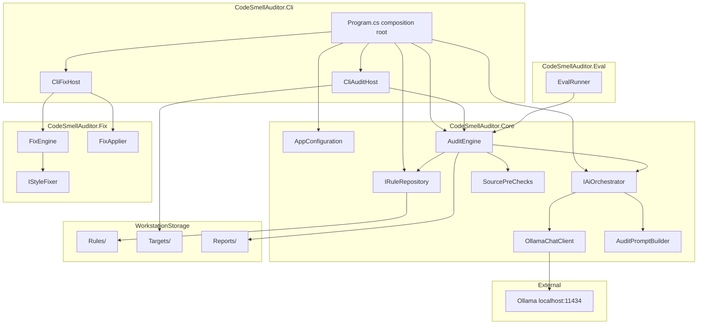

# Architecture

## Overview

CodeSmellAuditor follows a simple layered design with explicit interfaces so the audit engine stays independent of rule storage format and AI provider. Cli owns interactive presentation; Core owns configuration, rule loading, pre-checks, single-file and multi-file (system) audits, and report persistence; Fix owns the model-free style fixes; Eval scores audits against fixed answer keys.



## Projects

| Project | Responsibility |
|---------|---------------|
| CodeSmellAuditor.Cli | Composition root, `CliAuditHost` audit UX (Spectre Status + streaming), `CliFixHost` fix UX |
| CodeSmellAuditor.Core | `AuditEngine` file-level audit API, interfaces, application configuration, Ollama HTTP client, prompt budgeting |
| CodeSmellAuditor.Fix | Roslyn-based style fixers, `FixEngine` planning and validation, `FixApplier` file writes, line diff |
| CodeSmellAuditor.Eval | Benchmark runner, answer-key scoring, results table |
| CodeSmellAuditor.Core.Tests | xUnit tests for Core, Cli argument parsing, Fix, and Eval, using fakes in place of Ollama |

## Key types

### IRuleRepository

Loads active governance rules from a folder. `MarkdownRuleRepository` reads `.mdc` audit packs by default; reference `.md` manuals are excluded from runtime prompts. Compact excerpts keep prompts within local model context; report shape is owned by `AuditPromptBuilder`. Root `Rules/*.mdc` are stack-agnostic. Opt-in stack packs live under `Rules/Stacks/<name>/` (loaded only when `--stack` is set). Architecture packs under `Rules/Architecture/` are used by sniff-system.

### IAiOrchestrator

Sends source code and rules to an AI backend and returns an `AuditReport` with an `AuditOutcome` (`Passed`, `ReviewRequired`, or `Failed`). Supports single-file `AnalyzeCodeAsync` and multi-file `AnalyzeSystemAsync`. `OllamaAiOrchestrator` builds the prompts, streams tokens through an injected `OllamaChatClient`, and uses bounded output templates. Transport, empty-response, and budget failures map to `Failed` and are not persisted as critiques. Both methods accept a `CancellationToken`; a cancelled audit throws `OperationCanceledException` and writes no report.

### OllamaChatClient

Calls Ollama `/api/chat` over an injected `HttpClient` (bound at the composition root) with thinking disabled. It offers a streaming and a single-response call, and returns the content, the error text Ollama reports, whether the output limit ended the reply (`done_reason`), and the token counts. HTTP failures surface as exceptions.

### AppConfiguration

Resolves the storage path, audit model, fix model, context limits, and stack for a host. Environment variables win over caller-supplied values. The fix model defaults to the audit model, and the storage path defaults to the nearest `WorkstationStorage` folder above the executable.

### AuditPromptBuilder

Assembles system instructions, rule excerpts, and source text. Enforces a character budget before calling Ollama.

### AuditEngine

Presentation-neutral domain API:

1. `LoadRulesAsync` - load compact rules (optional stack name concatenates `Rules/Stacks/<name>/`)
2. `LoadSystemRulesAsync` - Architecture packs plus optional stack packs for sniff-system
3. `EnumerateTargetFiles` / `ResolveExistingCsPaths` / `ResolveReportsDirectory` / `ResolveArchitectureRulesPath` / `ResolveStackRulesPath` - storage helpers
4. `AuditFileAsync` - analyze one file, optional token callback, ground the findings, persist the markdown report and summary sidecar when outcome is not `Failed`
5. `AuditSystemAsync` - analyze two or more files as one architecture audit (optional manifest text)
6. `RunBatchAsync` - headless multi-file run without console output; the CLI drives its own loop through `CliAuditHost`

### SystemAuditPromptBuilder

Assembles architecture-mode system/user prompts (manifest + multi-file sources) with a larger character budget via `AuditConfiguration.ForSystemAudit`. Single-file prompts stay in `AuditPromptBuilder`.

### Finding grounding

`AuditFindingParser` reads structured findings (Id, File, Line, Rule, Fix, Evidence, Issue) from `## Top Findings` or `## Cross-File Findings`, tolerating layout drift from small models. `FindingGroundingValidator` checks each Evidence quote against the audited source (whitespace-insensitive; `...` marks a gap within one line; quotes under 12 characters are rejected) and records the verified line. `AuditGrounding` turns the model Status plus grounded findings into the final `AuditOutcome`. `AuditSummaryFormatter` appends a `## Grounding` section to the report and writes the JSON sidecar. Grounding happens in `AuditEngine`, so `IAiOrchestrator` implementations stay unaware of it.

### Pre-checks

`SourcePreChecks` decides, from the source text alone, the rules that need no judgment:

| Check | Fires on |
|-------|----------|
| `multiple-top-level-types`, `file-name-mismatch` | More than one top-level type per file; a file name that differs from its only type |
| `wip-marker` | Unresolved `TODO`/`FIXME`/`HACK`/`TEMP`/`WIP` comments, `#if false` blocks, `NotImplementedException` stubs |
| `commented-out-code` | Runs of two or more commented-out code lines |
| `static-mutable-field` | A `static` field that is neither `readonly` nor `const` in a non-static type |
| `private-field-naming` | A private instance field that starts uppercase or with `m_`, `s_`, `k_` (`_camelCase` is accepted) |
| `constructor-too-large` | More than five constructor parameters on a class or struct, primary constructors included; positional records are exempt |
| `enum-only-file` | A file whose only top-level type is a non-public enum |
| `empty-catch` | A `catch` block with no statements, whether or not it holds a comment |
| `hidden-dependency-lookup` | `ServiceLocator.` access; with the Unity stack also `FindObjectOfType` and its variants, `GameObject.Find`, `Resources.Load` |
| `non-ascii-comment` | Comment text with non-ASCII characters (one finding per file with the line count) |
| `region-block` | With the Unity stack, `#region` names outside Serialized Fields, Lifecycle, Public API, Private Helpers (one finding per file) |

`CSharpSourceScanner` splits each line into code and comment text and blanks string and char literals, so literal content is never read as a marker or a declaration. `CSharpMemberScanner` tracks braces to separate type bodies from method and property bodies and lists the type declarations and the member statements directly inside type bodies; the declaration checks read from it. Both are lexical passes, not parsers. `AuditEngine` runs the checks for single-file audits with the active stack name, appends a `## Pre-checks` section, and writes the findings to the sidecar. Any finding holds the final status at review required even when the model reports compliant. System audits do not run them.

### Style fixes

`CodeSmellAuditor.Fix` rewrites files for rules that can be fixed mechanically, without a model. Each rule has one `IStyleFixer` that is deterministic and idempotent and reports its edits (`FixChange`) and the violations it left alone (`FixSkip`, with the reason). `PrivateFieldNamingFixer` renames private instance fields that are not camelCase through Roslyn's symbol rename, so every reference in the file follows and name conflicts are qualified. It skips fields that carry attributes other than a small neutral set (the name may be a serialization contract), fields of partial types, names that would be keywords, and names that already exist in the type. It uses the same predicate as the `private-field-naming` pre-check. `RegionFixer` removes `#region` and `#endregion` lines whose name is not one of the fixed structural names (Serialized Fields, Lifecycle, Public API, Private Helpers), found through the syntax tree so text in strings and comments is never touched; the code between the directives is unchanged, and a region without a matching `#endregion` is skipped.

`FixEngine` accepts a fixer result only when the file compiles with the same number of errors as before and a second run of the fixer changes nothing; a rejected result leaves the file as it was and is reported. The compilation uses the .NET runtime references only, so types from other assemblies stay unresolved on both sides of the comparison. `FixApplier` writes a file only if its hash still matches the one read when planning, keeps the original encoding, BOM and line endings, and writes a `.bak` copy when the file is not inside a git checkout. `LineDiff` produces the changed lines with context for the preview.

### CliAuditHost

Owns the batch and sniff loops. For each target it wraps `AuditFileAsync` in `AnsiConsole.Status()` so the spinner covers time-to-first-token, then streams tokens and prints the saved report path. `RunSniffSystemAsync` uses one Status wrap for the whole combined call.

### CliFixHost

Expands the `fix` paths through `SourceFileEnumerator` (folders are scanned recursively, skipping build, package, and IDE folders and generated files), plans with `FixEngine`, and prints the diff, the skipped violations, and the rejected files. It offers to apply all changes, review file by file, or cancel, and writes the chosen files through `FixApplier`.

## Design decisions

| Decision | Rationale |
|----------|-----------|
| Interfaces for rules and AI | Swap the rule source or AI backend without changing the engine; tests use fakes |
| Cli owns Status wrapping | Spectre Status must wrap the await; presentation stays out of Core |
| File-level Core API | Keeps Core modular; Cli drives one or more files via sniff while Core stays per-file; sniff-system is an explicit multi-file sibling API |
| Streaming token callback | Immediate feedback without Core knowing about the console |
| Compact `.mdc` rules at runtime | Keeps prompt size within local model context |
| Architecture rules under `Rules/Architecture/` | System audits do not inflate single-file prompts |
| Stack packs under `Rules/Stacks/<name>/` | Stacks such as Unity are opt-in via `--stack`; default packs stay stack-agnostic |
| Bounded report template | Prevents reasoning models from consuming output budget |
| Status line parsing | Deterministic pass/fail from `Status:` line |
| Exact rules in code, not in the model | Rules decidable from text (see Pre-checks) are checked deterministically, so a small model cannot miss them and they cost no model calls |
| Grounding in code, not in the model | Small local models invent or misplace findings; verifying quotes against the source is exact and costs no model calls |
| Score is informational | Model-emitted qualitative signal; not used for exit codes or regression |
| Env vars for storage, model, and context config | Portable across machines; `CODESMELL_FIX_MODEL` names the fix model; `CODESMELL_NUM_CTX` and `CODESMELL_NUM_PREDICT` apply to batch and sniff, while sniff-system uses its fixed larger budget |

## Dependency direction

```
Cli  -> Core -> (filesystem, HttpClient)
Cli  -> Fix  -> (Roslyn, filesystem)
Eval -> Core
```

Core does not reference Cli or Fix; Fix does not reference Core. AI calls and rule loading are behind interfaces. `AuditEngine` reads source files and writes reports directly through `System.IO`.

## CLI entry points

| Mode | Invocation | Source | Exit behavior |
|------|------------|--------|---------------|
| Batch | no args | `WorkstationStorage/Targets/*.cs` | Summary; exit `0`/`1`/`2`; Enter-to-exit unless `--non-interactive` |
| Sniff | `sniff path\to\File.cs [more.cs...]` | one or more external paths in place | no Enter wait; exit `0`/`1`/`2` from aggregate outcome |
| Sniff-system | `sniff-system path\to\A.cs path\to\B.cs [...]` | two or more external paths; optional `--manifest` | one combined architecture report; no Enter wait; exit `0`/`1`/`2` |
| Fix | `fix path\to\Folder-or-File.cs [...]` | files and folders, scanned recursively; no rules folder or Ollama needed | diff preview, then apply all, review file by file, or cancel; `--yes` writes without asking, `--dry-run` never writes, `--non-interactive` writes only with `--yes` |

### Shared options

| Flag | Purpose | Override |
|------|---------|----------|
| `--model <name>` | Ollama model for this run | `CODESMELL_MODEL` wins when set |
| `--storage <path>` | WorkstationStorage root | `CODESMELL_STORAGE` wins when set |
| `--stack <name>` | Opt-in stack pack under `Rules/Stacks/<name>/` (e.g. `Unity`) | — |
| `--manifest <path>` | Free-text architecture contract (sniff-system only) | — |
| `--non-interactive` | Skip batch Enter wait | — |

Flags may appear before or after `sniff` / `sniff-system`.

Batch and sniff reuse `CliAuditHost` Status wrapping and `AuditEngine.AuditFileAsync` with root `Rules/*.mdc`. Optional `--stack` concatenates `Rules/Stacks/<name>/*.mdc` onto that set. Sniff-system uses `AuditEngine.LoadSystemRulesAsync` (Architecture packs plus optional stack packs), `AuditSystemAsync` / `AnalyzeSystemAsync` with a larger `AuditConfiguration.ForSystemAudit` budget, and writes one `SystemAudit_*_Critique.md` report when the outcome is not `Failed`. Rules and reports always come from auditor storage; sniff modes never copy into Targets. Empty batch runs (no `*.cs` targets) exit `1`. Argument, wiring, and missing-path errors at the CLI exit `2`. Multi-path sniff loads rules once and audits files sequentially. `scripts/sniff.ps1` forwards `-Target` paths plus optional `-Model` / `-Storage` / `-Stack`; `-System` and `-Manifest` map to `sniff-system`.

### Report contract

| Field | Role |
|-------|------|
| `Status:` | Model verdict (`COMPLIANT` or `REVIEW REQUIRED`). Missing or invalid fails closed to review required. |
| Findings | `## Top Findings` (single file) or `## Cross-File Findings` (system): `[F1] File: \| Line: \| Rule: \| Fix: mechanical\|judgment`, then `Evidence:` (one source line, verbatim) and `Issue:`. `- None` when there are none. |
| Final status | With a findings section: review required when at least one finding is grounded, compliant when none are, regardless of the model Status. Without one: the model Status decides. Review required whenever the output limit cut the report before the findings ended. Maps to exit `0` or `1`. |
| `## Pre-checks` | Appended by the tool for single-file audits: exact findings (`P1`, `P2`, ...) with check name, line, and message, or `None.`. Any finding keeps the final status at review required. |
| `## Grounding` | Appended by the tool: model vs final status, counts, and per-finding grounded / ungrounded with verified `file:line` or the reason. |
| `*_Critique.summary.json` | Sidecar with `contractVersion`, `target`, `report`, `modelStatus`, `status`, `findingsSectionFound`, `findingsTruncated`, `grounded`, `ungrounded`, and `findings` (`id`, `file`, `line`, `rule`, `fix`, `grounded`, `issue`, `evidence`, `note`), and `usage` when Ollama reports token counts (`promptTokens`, `outputTokens`, `promptChars`, `numCtx`, `charsPerToken`, `contextHeadroomTokens`), and `preChecks` for single-file audits (`id`, `check`, `line`, `message`, `evidence`). |
| Tool failure | Ollama unreachable, empty response, budget exceeded, or CLI wiring errors. Maps to `AuditOutcome.Failed` / exit `2`; no critique file written; the cause is printed. |
| `Score:` | Rough qualitative signal for that run only. Model-emitted, non-deterministic; not a regression metric. Status and Top Findings carry the verdict; Score differences between runs are not comparable. |

### Exit codes

| Code | Meaning |
|------|---------|
| `0` | Every audited target passed (final status `COMPLIANT`) |
| `1` | At least one final `REVIEW REQUIRED`, or empty batch (nothing to pass); no tool failures |
| `2` | At least one tool/wiring failure (`Failed`), or CLI could not start the audit (invalid arguments, missing Rules/Targets, bad paths, missing stack folder) |

`fix` exit codes: `0` when nothing is pending or everything planned was written, `1` when planned changes were not written (dry run, declined, or a file changed after planning), `2` when a fix was rejected or a path was invalid.

## Evaluation

`CodeSmellAuditor.Eval` scores the audit output against fixed answer keys. `eval/fixtures/` holds five C# fixtures, each with a `*.key.json`: planted rule-shaped issues, planted judgment-level defects, a clean control that must come back `COMPLIANT`, a file near the input character budget, and a Unity file audited with `--stack Unity`. A key item has an id, a kind (`blatant` or `judgment`), a line range, text patterns, and optionally the pre-check that can satisfy it.

Each fixture is audited through `AuditEngine` and read back from its summary sidecar. A grounded finding hits an item when its evidence line lies within the item's range (plus a two-line tolerance, with the line re-derived from where the evidence appears in the source) and its text matches a pattern; each finding satisfies at most one item. Grounded findings that satisfy none are noise, and any finding on the clean control is a false positive. Pre-check hits are counted separately from model hits.

A run repeats the corpus several times and records the mean and min-max spread per metric as one row of an append-only CSV, with the git sha and content hashes of the corpus, prompt, rule packs, and Core sources. A regenerated markdown table compares each row with the previous row of the same model and marks changes inside the repeat spread. The results and raw reports live under `eval/results/`, outside version control. The token cost of reading the output is estimated from text size in three variants: the report, the sidecar alone, and the report with the source.
